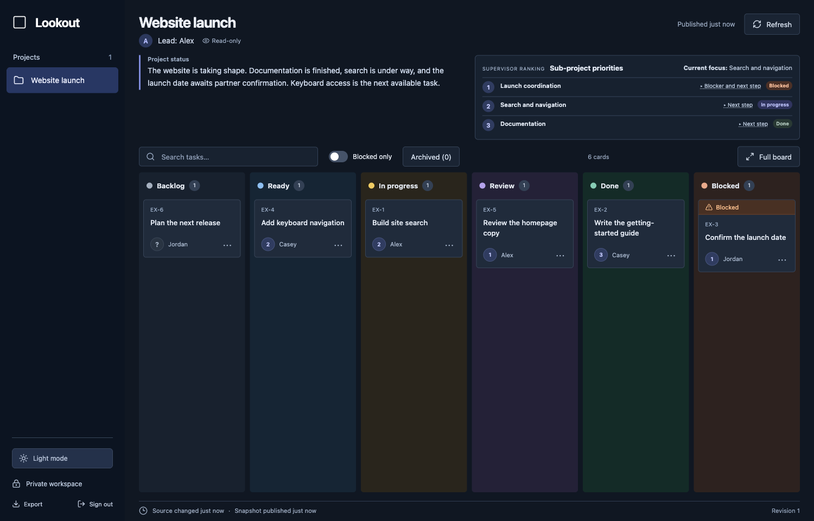

# Lookout

**See what your projects are doing, without chasing status updates.**

[](https://github.com/RobRipley/lookout/actions/workflows/ci.yml)
[](LICENSE.md)

Lookout is a private project dashboard built by [Rob Ripley](https://github.com/RobRipley). Project leads and AI agents publish snapshots from the boards they already use. You get one visual place to see progress, blockers, and what deserves attention next.

The source board stays authoritative. Lookout is its readable, shared window.



*Example workspace with fictional data.*

## What it does

- Switch between projects with their original workflow columns.
- Read a short plain-English project status beside ranked sub-project priorities.
- See each task's priority number and owner; hover for its sub-project name.
- Click unfamiliar terms for a contextual explanation.
- Search, filter blocked work, and open a full-board view with compact cards.
- Archive completed work, inspect archived cards, and restore eligible tasks.
- Check source and publication timestamps, spot stale snapshots, and export your boards.
- Sign in with Internet Identity. Owners control access; publishers are scoped to individual projects.
- Use light or dark mode.

## Built for a small footprint

React and Vite serve the interface from an ICP asset canister. A Motoko canister stores boards, permissions, summaries, priorities, and archive records in persistent state. A Node.js publisher reads a selected Markdown table or curated JSON and sends authenticated updates.

There is no separate database or application server to operate. Canister execution and storage consume cycles. This repository contains application source and synthetic examples; it contains no production boards, invitations, identity keys, or deployment configuration.

## Run your own instance

Prerequisites: Node.js 22.12+ and npm, [icp-cli](https://github.com/dfinity/icp-cli), and [Mops](https://docs.mops.one/). The Motoko toolchain and libraries are pinned in `mops.toml`.

```sh
git clone https://github.com/RobRipley/lookout.git
cd lookout
npm ci
mops install
npm test
npm run build
```

Create a deployment identity using `icp identity new lookout-example`. Keep its recovery material private. Then prepare a fresh local installation:

```sh
node scripts/init-local.mjs lookout-example
icp network start local -d
icp deploy -e local --identity lookout-example
LOOKOUT_TEST_NETWORK=local LOOKOUT_TEST_IDENTITY=lookout-example node tests/backend.integration.mjs
```

The initialization helper writes private installation arguments to `work/install-args.did` and an owner invitation to `work/owner-invite.txt`. It refuses to overwrite either file. The integration suite is for a disposable local instance and creates synthetic boards and grants; it must not be run against a workspace you use.

For browser login, deployment, recovery, and configuration, see [Setup](docs/SETUP.md). To connect a project or agent, see [Publishing](docs/PUBLISHING.md). You can inspect the interface with `npm run dev`; authenticated data requires a configured backend and identity flow.

## Priority-driven supervision

The priority list is a ranking of sub-projects, separate from card status. Work on the highest-ranked actionable item. If it becomes blocked, record the blocker and next step, then move to the next actionable item. Recheck the blocked item and return to it when it becomes actionable. Priorities guide attention; they do not grant permission for deployments, transactions, or other protected actions.

Publish whenever a task's state, blocker, owner, next action, or priority changes. This is an explicit publisher integration, not automatic discovery of every agent or project.

## Scope and limits

Lookout currently supports one private workspace per backend, up to 30 projects, 500 cards per project, and 12 columns. It mirrors boards rather than providing drag-and-drop editing of their source. It has no billing, public signup, attachments, or bidirectional synchronization.

Completed cards with a recorded completion time become archived after 72 hours. Authorized project publishers and admins can also archive or restore eligible completed cards. A restored card is retained until its completion cycle changes. If the source removed a card, its archived copy remains readable but cannot be restored into the active mirror. Archive storage is bounded.

## License

Copyright 2026 Rob Ripley. Licensed under the [Functional Source License 1.1, Apache 2.0 future license](LICENSE.md) (`FSL-1.1-ALv2`).

You may study, modify, and use Lookout internally under the license. Competing commercial products and services are restricted during the first two years of each published version. That version becomes available under Apache 2.0 on its second anniversary. This is **source-available software**, not an OSI-approved open-source license during that initial period. The license text controls; see [the FSL project](https://fsl.software/) for background. Dependencies retain their own licenses.
